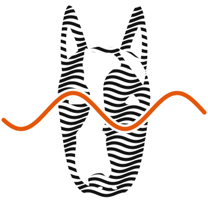
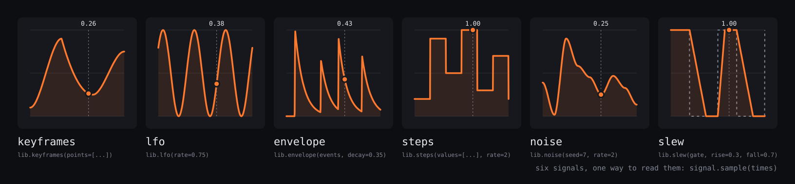

<p align="center">
  
</p>

<h1 align="center">bullterrier-control</h1>

<p align="center">
  <b>Control signals for Python.</b><br>
  Keyframes with easing, LFOs, envelopes, step sequences and seeded noise, shaped by slew and clip,<br>
  read at any moment in seconds. The same inputs and seed always give the same values.
</p>

<p align="center">
  <a href="https://github.com/bullterrier-studio/bullterrier-control/actions/workflows/ci.yml"></a>
  
  
  
  
  
  
</p>

<p align="center">
  
</p>

It answers "what is this value at 12.4 s?". It never touches pixels or sound, and what the value drives is up to you: an
image effect, a synthesizer, a light, a MIDI controller. DAWs call this automation, animation tools keyframes and
synthesizers modulation.

<table>
  <tr>
    <td width="33%" valign="top"><b>Read at any moment</b><br>A signal has a value at every time. <code>sample(times)</code> takes a number or an array of seconds, in any order, and returns values in the same shape. No clock, no frames.</td>
    <td width="33%" valign="top"><b>Sources and shapers</b><br>Keyframes, LFOs, envelopes, steps, noise and latches make signals; slew, follow, gate, hold, remap, delay and clip shape them. Signals combine with <code>+</code>, <code>-</code>, <code>*</code>, <code>minimum</code> and <code>maximum</code>.</td>
    <td width="33%" valign="top"><b>Deterministic</b><br>The same inputs and seed give the same values, whatever the order or number of earlier reads. Noise is the same on every machine.</td>
  </tr>
  <tr>
    <td width="33%" valign="top"><b>Parameters declared once</b><br>Every parameter has a unit, a range and a description. <code>help(btc.lib.slew)</code> lists them, and a bad value fails with the field and the value.</td>
    <td width="33%" valign="top"><b>Plain data in and out</b><br>Measurements and curves travel as one JSON file, a bundle, with a JSON Schema for tools in other languages. <code>bt-control validate</code> checks one.</td>
    <td width="33%" valign="top"><b>Small and extensible</b><br>Two dependencies, numpy and pydantic. Offline. A package of your own sources and shapers plugs in as an entry point.</td>
  </tr>
</table>

## Contents

[Install](#install) | [Quick start](#quick-start) | [Sources and shapers](#sources-and-shapers) | [Concepts](#concepts) |
[Formats](#formats) | [Status](#status) | [Development](#development) | [Works with](#works-with) | [License](#license)

## Install

Requires Python 3.12+. Pre-alpha, not yet on PyPI. From GitHub:

```bash
pip install git+https://github.com/bullterrier-studio/bullterrier-control.git
```

From a checkout, with [uv](https://docs.astral.sh/uv/):

```bash
git clone https://github.com/bullterrier-studio/bullterrier-control.git
cd bullterrier-control
uv sync
uv run bt-control --help
```

## Quick start

The docs import the package as `btc`. Measurements in, shaped and read at times of your choosing:

```python
import bullterrier_control as btc

energy = btc.from_series(btc.Series(rate=10, values=(0.0, 1.0, 0.2, 0.0), unit=btc.Unit.RATIO))  # a measured curve
smooth = btc.lib.slew(energy, rise=0.2, fall=0.5)  # climbs and falls no faster than this
clipped = btc.lib.clip(smooth, low=0.1, high=0.8)  # and stays between 0.1 and 0.8
clipped.sample([0.0, 0.1, 0.2, 0.3, 1.0])  # values at those times, in seconds
# array([0.1  , 0.5  , 0.566, 0.366, 0.1  ])
```

A consumer can read a whole timeline in one call, since `sample` takes an array; reading one time per call gives the
same values.

Keyframes: values at chosen times, eased between ([docs/examples.md](docs/examples.md) works this one out by hand):

```python
import bullterrier_control as btc

ramp = btc.lib.keyframes(points=[{"t": 0, "value": 0, "ease": "in-out"}, {"t": 5, "value": 0.9}])
ramp.sample([1.0, 2.5, 7.0])  # the ease belongs to the segment that starts at its point; the last value holds
# array([0.0936, 0.45  , 0.9   ])
```

Envelopes: a flare on each event, here a kick at 0.5 s that fades with a time constant of 0.25 s:

```python
import bullterrier_control as btc

flare = btc.lib.envelope(events=[{"t": 0.5}], decay=0.25)
flare.sample([0.25, 0.5, 0.75, 1.0])  # 0 before the kick, 1 at it, then e^-1 and e^-2
# array([0.    , 1.    , 0.3679, 0.1353])
```

## Sources and shapers

**Sources** make a signal from their parameters and, for some, from data such as keyframes, events or a beat grid.
**Shapers** make a signal from a signal. Both are in `btc.lib`: `dir(btc.lib)` lists them, `help(btc.lib.slew)` shows every
parameter with its unit and range.

| Name | Kind | What it makes |
|---|---|---|
| `keyframes` | source | Passes through values at chosen times, easing from each point to the next |
| `lfo` | source | A sine, triangle, square or saw wave between `low` and `high`, per second or per beat |
| `envelope` | source | Attack, decay, sustain and release on each event |
| `steps` | source | A list of values held one step each, repeating, per second or per beat |
| `noise` | source | Seeded random values, held, joined by lines or eased |
| `latch` | source | One value until the first event with a label, another from then on |
| `constant` | source | One value at every time |
| `slew` | shaper | Follows its input but climbs and falls no faster than allowed |
| `follow` | shaper | Chases its input with its own attack and release times (equal times smooth) |
| `gate` | shaper | Turns its input into 0 and 1, opening and closing at two levels |
| `hold` | shaper | Takes the input's value at each event and keeps it until the next |
| `remap` | shaper | Puts a 0 to 1 input onto a range, bent by an ease |
| `delay` | shaper | Shows its input a fixed time late |
| `clip` | shaper | Follows its input but never leaves a range |

Operations on events and series come next ([docs/roadmap.md](docs/roadmap.md)). A package of your own imports `bullterrier_control.plugin` and
names its module as an entry point of the group `bullterrier_control.sources`; its sources then appear in `btc.lib`.

## Concepts

- **Signal**: a value at every time. `signal.sample(times)` takes a number or an array of times in seconds and returns the
  values in the same shape.
- **Event**: a moment in seconds with a strength, and optionally a duration, label and pitch: a beat, an onset, a cue.
- **Time is in seconds** everywhere. A value in beats is turned into seconds through a grid.
- **Parameters** are declared once, with a unit, a range and a description, and drive validation, defaults and `help()`.

## Formats

Measurements come in, and curves go out, as one JSON file, a *bundle* ([docs/formats.md](docs/formats.md)):

| Format | Meaning |
|---|---|
| Series | Values at a fixed rate, from a start time, with a unit |
| Event | A moment in seconds with a strength, and optionally a duration, label and pitch |
| Grid | Beat times, meter and first downbeat; converts beat positions and seconds |

```bash
bt-control validate analysis.json    # is this file a valid bundle?
bt-control schema                    # the JSON Schema of a bundle, for tools in other languages
```

## Status

Pre-alpha, not yet on PyPI. The formats and the core exist, with the sources `constant`, `keyframes`, `envelope`, `latch`,
`lfo`, `steps` and `noise` and the shapers `clip`, `delay`, `follow`, `gate`, `hold`, `remap` and `slew`.

## Development

```bash
uv sync
uv run poe check    # every gate: format, lint, dead code, types, tests
```

See [CONTRIBUTING.md](CONTRIBUTING.md). Every rule is in [CLAUDE.md](CLAUDE.md); the reasons are in
[docs/design-decisions.md](docs/design-decisions.md). The banner is drawn from the library itself:
`uv run python tools/make_banner.py`.

## Works with

bullterrier-control is one of five independent packages of [Bullterrier Studio](https://github.com/bullterrier-studio)
([docs/ecosystem.md](docs/ecosystem.md)). It depends on none of them. `bullterrier-audio` writes its measurements in this
package's formats without importing it; `bullterrier-video` reads signals from here and maps them onto the parameters of
`bullterrier-image` and `bullterrier-vector`.

## License

MIT, see [LICENSE](LICENSE).
