# Gallery

One picture per source and shaper, drawn from the patch under it over 4 seconds:
`uv run bt-control plot examples/gallery/NAME.toml --to 4 --out NAME.png`. A shaper's picture shows its input
as well. Generated by `uv run poe gallery`; edit the patches, not this page.

## Sources

### `constant`

A signal that holds one value at every time.

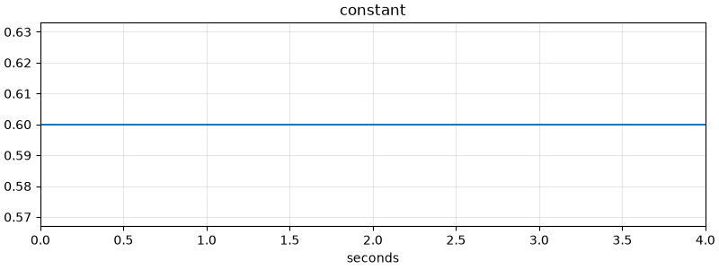

```toml
# constant: one value at every time
format = "bullterrier-control/patch"
version = 1

[constant]
use = "constant"
value = 0.6
```

### `envelope`

A signal that, on each event, rises to the event's strength over `attack`, falls toward `sustain` over `decay` and, once an event with a duration ends, falls to 0 over `release`.

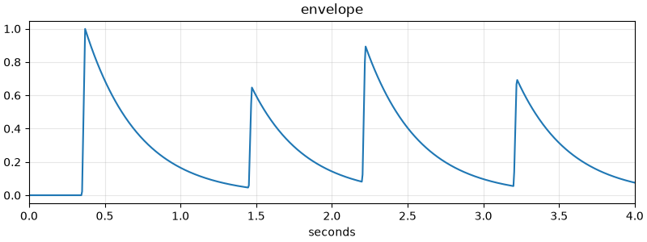

```toml
# envelope: a flare on each of four kicks, fading by e every 0.35 s
format = "bullterrier-control/patch"
version = 1

[envelope]
use = "envelope"
events = [{ t = 0.35, strength = 1.0 }, { t = 1.45, strength = 0.65 }, { t = 2.2, strength = 0.9 }, { t = 3.2, strength = 0.7 }]
attack = 0.02
decay = 0.35
```

### `keyframes`

A signal that passes through the given values at the given times, easing from each point to the next.

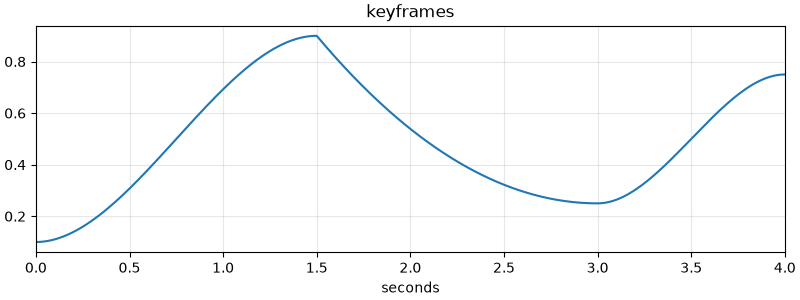

```toml
# keyframes: values at chosen times, eased between
format = "bullterrier-control/patch"
version = 1

[keyframes]
use = "keyframes"
points = [
    { t = 0, value = 0.1, ease = "in-out" },
    { t = 1.5, value = 0.9, ease = "out" },
    { t = 3, value = 0.25, ease = "in-out" },
    { t = 4, value = 0.75 },
]
```

### `latch`

A signal that is `before` until the first event with `label` and `after` from the moment of that event on.

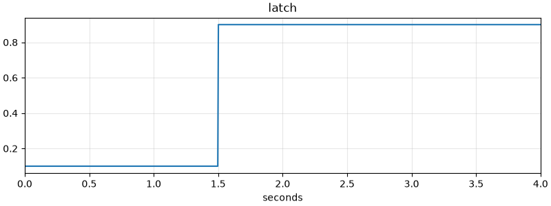

```toml
# latch: 0.1 until the event labelled drop at 1.5 s, 0.9 from then on
format = "bullterrier-control/patch"
version = 1

[latch]
use = "latch"
events = [{ t = 0.4, label = "kick" }, { t = 1.5, label = "drop" }]
label = "drop"
before = 0.1
after = 0.9
```

### `lfo`

A periodic wave between `low` and `high`, repeating `rate` times per second or per beat.

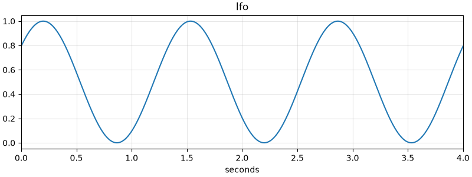

```toml
# lfo: a sine of three quarters of a cycle a second, started a tenth of a cycle in
format = "bullterrier-control/patch"
version = 1

[lfo]
use = "lfo"
shape = "sine"
rate = 0.75
phase = 0.1
```

### `noise`

Seeded random noise between `low` and `high`: a new random value every 1 / `rate` seconds, held, joined by straight lines or eased between them.

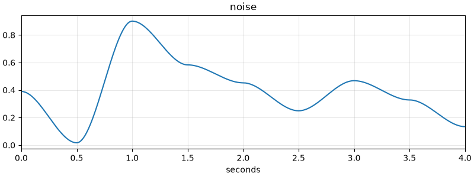

```toml
# noise: seeded random values, two a second, eased between
format = "bullterrier-control/patch"
version = 1

[noise]
use = "noise"
shape = "smooth"
rate = 2
seed = 7
```

### `steps`

A signal that steps through `values`, holding each for one step, and goes back to the first after the last.

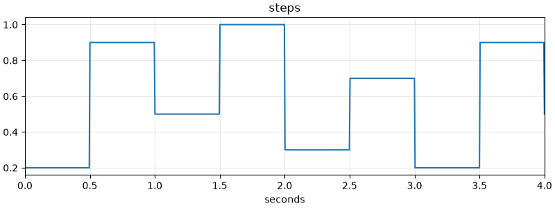

```toml
# steps: six values held half a second each, repeating
format = "bullterrier-control/patch"
version = 1

[steps]
use = "steps"
values = [0.2, 0.9, 0.5, 1.0, 0.3, 0.7]
rate = 2
```

## Shapers

### `clip`

A signal that follows its input but never leaves the range from `low` to `high`.

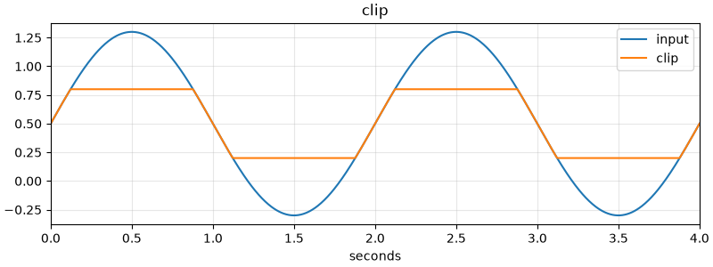

```toml
# clip: a sine that swings past 0 and 1, kept between 0.2 and 0.8
format = "bullterrier-control/patch"
version = 1

# a sine that swings past the range
[input]
use = "lfo"
rate = 0.5
low = -0.3
high = 1.3

[clip]
use = "clip"
signal = "input"
low = 0.2
high = 0.8
```

### `delay`

A signal that shows its input `lag` seconds late.

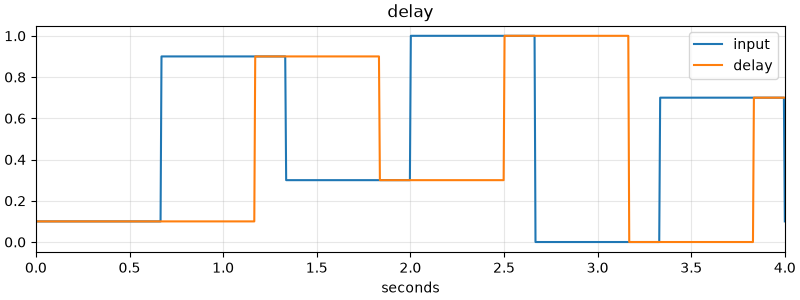

```toml
# delay: the staircase half a second late
format = "bullterrier-control/patch"
version = 1

# a staircase with jumps, for a shaper to work on
[input]
use = "steps"
values = [0.1, 0.9, 0.3, 1.0, 0.0, 0.7]
rate = 1.5

[delay]
use = "delay"
signal = "input"
lag = 0.5
```

### `follow`

A signal that chases its input like a capacitor: it closes a share of the gap to it with every step, at its own speed up (`attack`) and down (`release`).

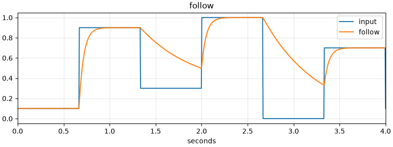

```toml
# follow: the staircase chased quickly upward and slowly downward
format = "bullterrier-control/patch"
version = 1

# a staircase with jumps, for a shaper to work on
[input]
use = "steps"
values = [0.1, 0.9, 0.3, 1.0, 0.0, 0.7]
rate = 1.5

[follow]
use = "follow"
signal = "input"
attack = 0.05
release = 0.6
```

### `gate`

A signal that is 1 while its input is high and 0 while it is low, with a gap between the levels that opens and closes it (hysteresis).

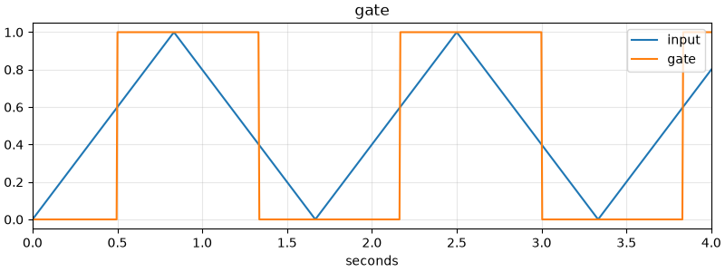

```toml
# gate: a triangle wave as 0 and 1, opening at 0.6 and closing below 0.4
format = "bullterrier-control/patch"
version = 1

# a triangle wave, for a shaper to work on
[input]
use = "lfo"
shape = "triangle"
rate = 0.6

[gate]
use = "gate"
signal = "input"
open = 0.6
close = 0.4
```

### `hold`

A signal that takes its input's value at each event and keeps it until the next event.

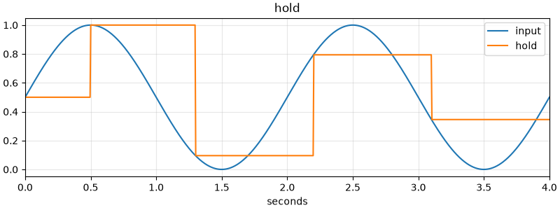

```toml
# hold: a sine sampled at four events and held until the next
format = "bullterrier-control/patch"
version = 1

# a slow sine, read only where the events fall
[input]
use = "lfo"
rate = 0.5

[hold]
use = "hold"
signal = "input"
events = [{ t = 0.5 }, { t = 1.3 }, { t = 2.2 }, { t = 3.1 }]
```

### `remap`

A signal that puts its input, taken as 0 to 1, onto the range from `low` to `high`, bent by an ease.

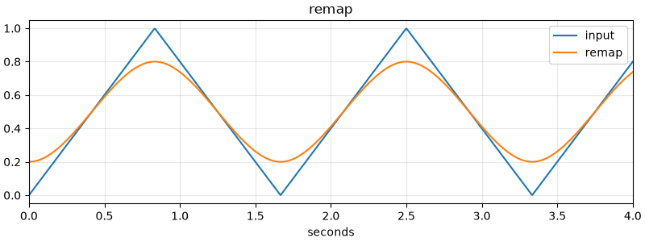

```toml
# remap: a triangle wave put onto 0.2 to 0.8, bent by an in-out ease
format = "bullterrier-control/patch"
version = 1

# a triangle wave, for a shaper to work on
[input]
use = "lfo"
shape = "triangle"
rate = 0.6

[remap]
use = "remap"
signal = "input"
low = 0.2
high = 0.8
ease = "in-out"
```

### `slew`

A signal that follows its input but climbs and falls no faster than `rise` and `fall` allow.

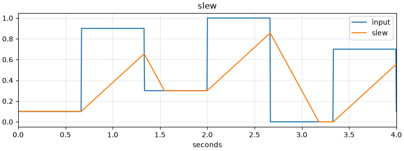

```toml
# slew: the staircase, climbing no faster than 1 in 1.2 s and falling no faster than 1 in 0.6 s
format = "bullterrier-control/patch"
version = 1

# a staircase with jumps, for a shaper to work on
[input]
use = "steps"
values = [0.1, 0.9, 0.3, 1.0, 0.0, 0.7]
rate = 1.5

[slew]
use = "slew"
signal = "input"
rise = 1.2
fall = 0.6
```
